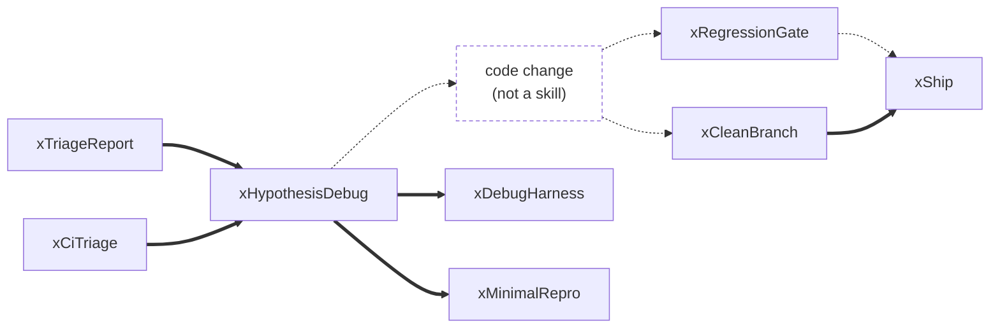
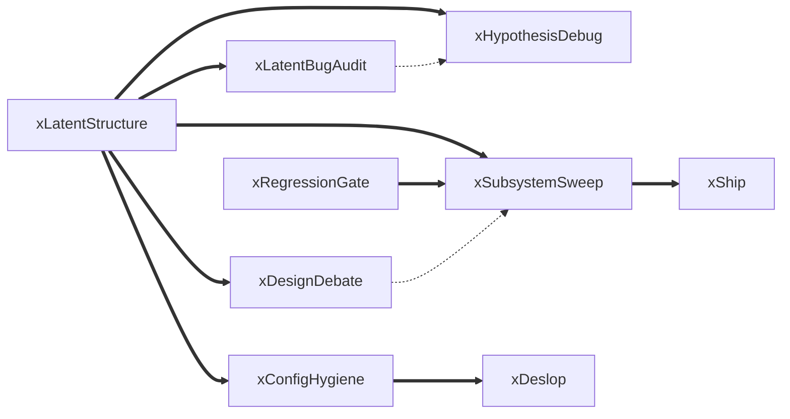
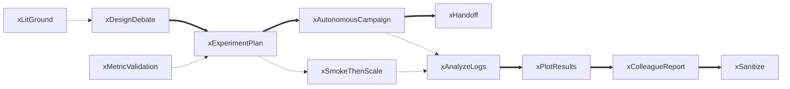
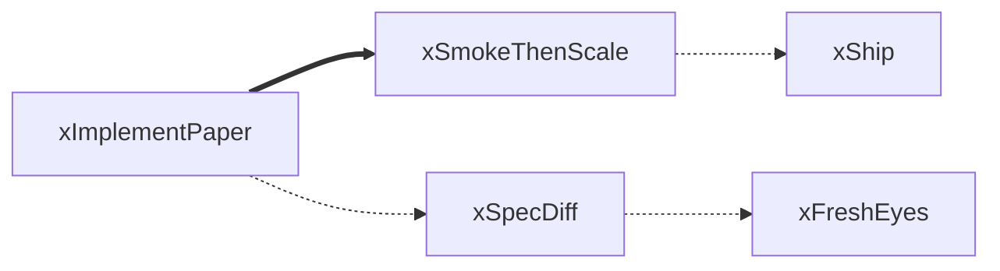
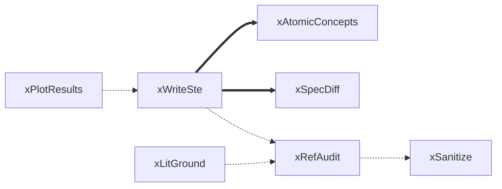
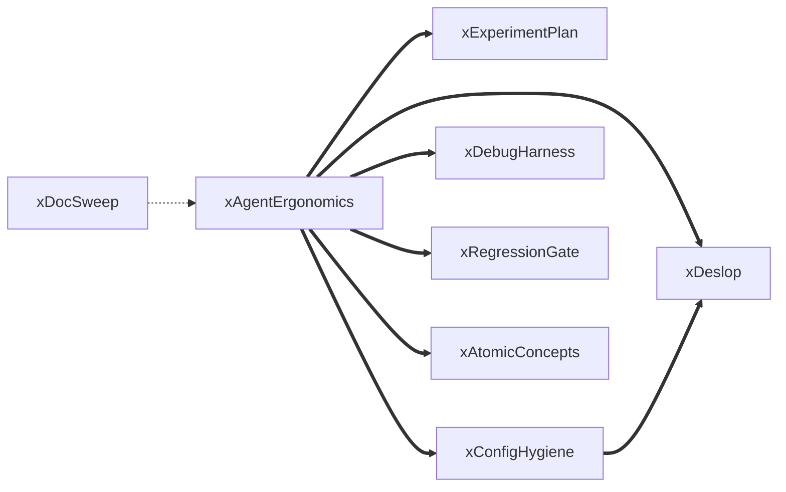
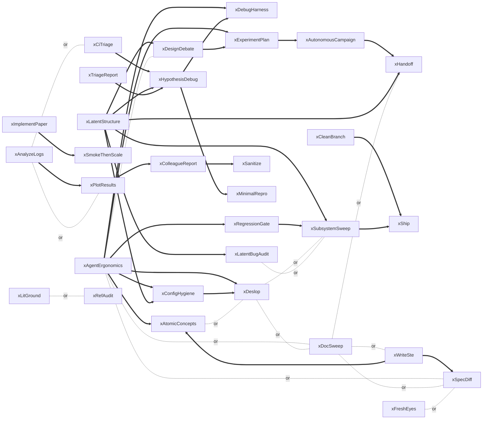

# Skill chains

Generated by `scripts/chains.py` from the skill-to-skill references in `skills/*/SKILL.md`. Edit
the script, not this file. `python3 scripts/chains.py --check` fails when this file or the README
figures are stale, or when a reference has no classification.

`==>` stated in a SKILL.md · `-.->` proposed, in no SKILL.md · arrows run in execution order.

45 references: 16 name an alternative, 29 are chain steps.

## Workflows

### Fix a defect

From a report, a CI failure or a playtest list, to a shipped fix. 5 stated, 4 proposed.

### Structure audit to refactor

xLatentStructure records go to the skill that acts on them. 8 stated, 2 proposed.

### Experiment lifecycle

From a design question to a report for collaborators. 6 stated, 5 proposed.

### Paper to code

Implement a published method and land it. 1 stated, 3 proposed.

### Write and submit a paper

From figures to a submission. 2 stated, 4 proposed.

### Docs and agent ergonomics

Tracking docs to a redesigned plan whose milestones each name a skill. 7 stated, 1 proposed.

## All stated references

`-. or .-` joins alternatives.

| Skills | |
|---|---|
| in no reference | xMetricValidation, xShowMe |
| in no chain step | xDocSweep, xFreshEyes, xLitGround, xMetricValidation, xRefAudit, xShowMe |
| in no workflow | xShowMe |

## References

| A | B | Kind | Site |
|---|---|---|---|
| xAgentErgonomics | xAtomicConcepts | A then B | `skills/xAgentErgonomics/SKILL.md:146` |
| xAgentErgonomics | xConfigHygiene | A then B | `skills/xAgentErgonomics/SKILL.md:142` |
| xAgentErgonomics | xDebugHarness | A then B | `skills/xAgentErgonomics/SKILL.md:143` |
| xAgentErgonomics | xDesignDebate | alternative | `skills/xAgentErgonomics/SKILL.md:10` |
| xAgentErgonomics | xDeslop | A then B | `skills/xAgentErgonomics/SKILL.md:147` |
| xAgentErgonomics | xDocSweep | alternative | `skills/xAgentErgonomics/SKILL.md:12` |
| xAgentErgonomics | xExperimentPlan | A then B | `skills/xAgentErgonomics/SKILL.md:137` |
| xAgentErgonomics | xRegressionGate | A then B | `skills/xAgentErgonomics/SKILL.md:144` |
| xAgentErgonomics | xSpecDiff | alternative | `skills/xAgentErgonomics/SKILL.md:11` |
| xAnalyzeLogs | xCiTriage | alternative | `skills/xAnalyzeLogs/SKILL.md:6` |
| xAnalyzeLogs | xPlotResults | alternative | `skills/xAnalyzeLogs/SKILL.md:6` |
| xAutonomousCampaign | xExperimentPlan | B before A | `skills/xAutonomousCampaign/SKILL.md:21` |
| xAutonomousCampaign | xHandoff | A then B | `skills/xAutonomousCampaign/SKILL.md:49` |
| xCiTriage | xAnalyzeLogs | alternative | `skills/xCiTriage/SKILL.md:6` |
| xCiTriage | xHypothesisDebug | A then B | `skills/xCiTriage/SKILL.md:47` |
| xCleanBranch | xShip | A then B | `skills/xCleanBranch/SKILL.md:7` |
| xColleagueReport | xPlotResults | B before A | `skills/xColleagueReport/SKILL.md:33` |
| xColleagueReport | xSanitize | A then B | `skills/xColleagueReport/SKILL.md:50` |
| xConfigHygiene | xDeslop | A then B | `skills/xConfigHygiene/SKILL.md:36` |
| xDeslop | xAtomicConcepts | alternative | `skills/xDeslop/SKILL.md:15` |
| xDocSweep | xDeslop | alternative | `skills/xDocSweep/SKILL.md:17` |
| xDocSweep | xHandoff | alternative | `skills/xDocSweep/SKILL.md:18` |
| xDocSweep | xSpecDiff | alternative | `skills/xDocSweep/SKILL.md:18` |
| xDocSweep | xWriteSte | alternative | `skills/xDocSweep/SKILL.md:17` |
| xExperimentPlan | xDesignDebate | B before A | `skills/xExperimentPlan/SKILL.md:7` |
| xFreshEyes | xSpecDiff | alternative | `skills/xFreshEyes/SKILL.md:7` |
| xHypothesisDebug | xDebugHarness | A then B | `skills/xHypothesisDebug/SKILL.md:43` |
| xHypothesisDebug | xMinimalRepro | A then B | `skills/xHypothesisDebug/SKILL.md:43` |
| xImplementPaper | xSmokeThenScale | A then B | `skills/xImplementPaper/SKILL.md:45` |
| xLatentStructure | xConfigHygiene | A then B | `skills/xLatentStructure/SKILL.md:107` |
| xLatentStructure | xDesignDebate | A then B | `skills/xLatentStructure/SKILL.md:106` |
| xLatentStructure | xHandoff | A then B | `skills/xLatentStructure/SKILL.md:54` |
| xLatentStructure | xHypothesisDebug | A then B | `skills/xLatentStructure/SKILL.md:104` |
| xLatentStructure | xLatentBugAudit | A then B | `skills/xLatentStructure/SKILL.md:11` |
| xLatentStructure | xSubsystemSweep | A then B | `skills/xLatentStructure/SKILL.md:11` |
| xPlotResults | xAnalyzeLogs | B before A | `skills/xPlotResults/SKILL.md:6` |
| xRefAudit | xLitGround | alternative | `skills/xRefAudit/SKILL.md:10` |
| xSpecDiff | xFreshEyes | alternative | `skills/xSpecDiff/SKILL.md:16` |
| xSubsystemSweep | xDeslop | alternative | `skills/xSubsystemSweep/SKILL.md:19` |
| xSubsystemSweep | xLatentBugAudit | alternative | `skills/xSubsystemSweep/SKILL.md:19` |
| xSubsystemSweep | xRegressionGate | B before A | `skills/xSubsystemSweep/SKILL.md:88` |
| xSubsystemSweep | xShip | A then B | `skills/xSubsystemSweep/SKILL.md:88` |
| xTriageReport | xHypothesisDebug | A then B | `skills/xTriageReport/SKILL.md:29` |
| xWriteSte | xAtomicConcepts | A then B | `skills/xWriteSte/SKILL.md:32` |
| xWriteSte | xSpecDiff | A then B | `skills/xWriteSte/SKILL.md:38` |
