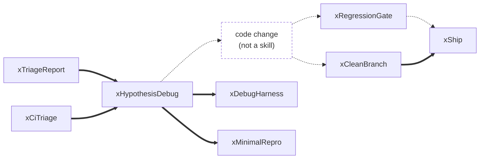
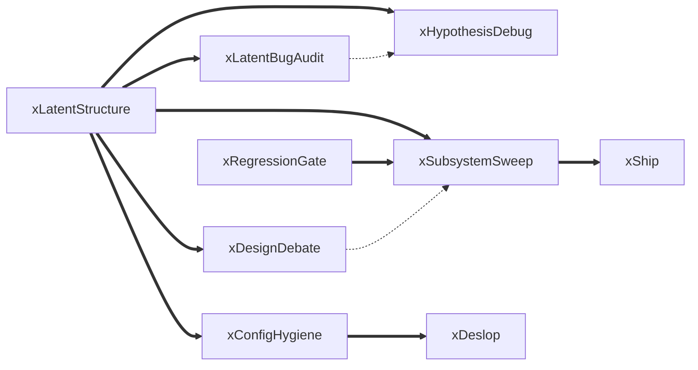
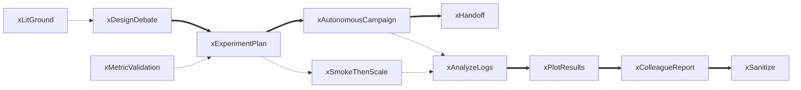
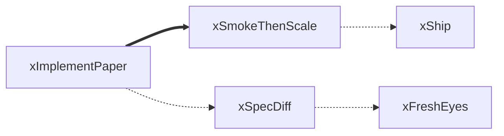
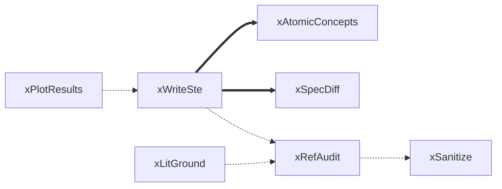
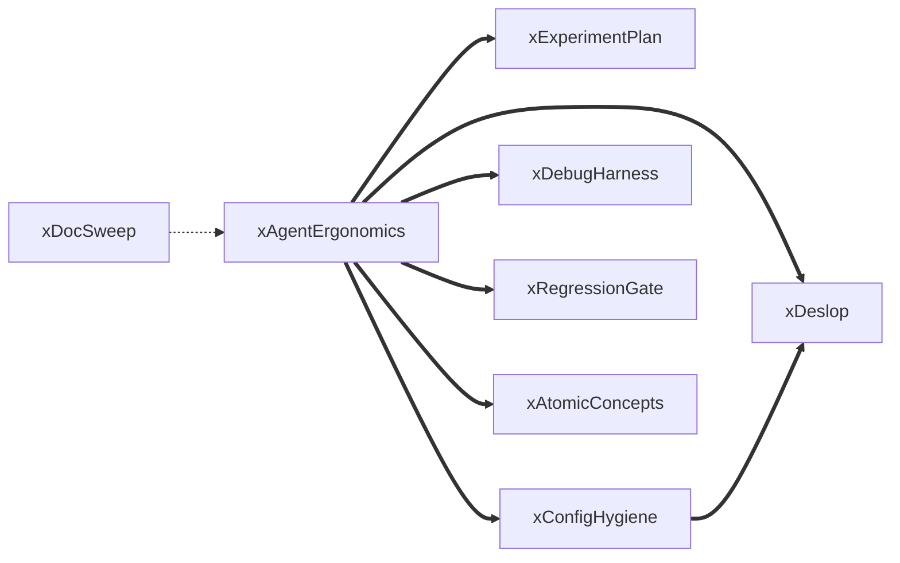

claudesci
---------

Skills and workflows for R&D.

<!-- chains:begin -->
## Skill chains

Suggested chains of skills. `==>` stated in a SKILL.md · `-.->` proposed, in no SKILL.md · arrows run in execution order. Details and the full reference graph: [CHAINS.md](CHAINS.md).

### Fix a defect

From a report, a CI failure or a playtest list, to a shipped fix. 5 stated, 4 proposed.

### Structure audit to refactor

xLatentStructure records go to the skill that acts on them. 8 stated, 2 proposed.

### Experiment lifecycle

From a design question to a report for collaborators. 6 stated, 5 proposed.

### Paper to code

Implement a published method and land it. 1 stated, 3 proposed.

### Write and submit a paper

From figures to a submission. 2 stated, 4 proposed.

### Docs and agent ergonomics

Tracking docs to a redesigned plan whose milestones each name a skill. 7 stated, 1 proposed.

<!-- chains:end -->
