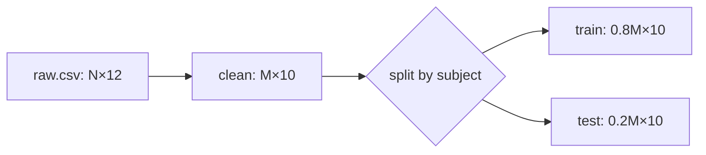

# Show me

Make the current point visible. Keep prose short.

Follow `${CLAUDE_SKILL_DIR}/../../CONVENTIONS.md`, in particular: verification proves execution and
questions get answers not edits.

## Input

The topic, normally the current discussion. Read the code, config or data the view shows before
you draw it.

## Procedure

1. **State the one point the view must make.** One view, one point. Add a second view only when
   the first cannot carry the point.

2. **Choose the form from the point:**

   | Point | Form |
   |---|---|
   | An algorithm or update rule | Pseudocode, with the equation beside it |
   | Which function calls which, at run time | Call tree |
   | Where data goes and how its shape changes | Data-flow diagram with shapes on the edges |
   | Interaction between processes, jobs or agents | Mermaid sequence diagram |
   | Which file owns what | Shallow file tree |
   | What a change does | `diff` of the pseudocode, call tree, config or file tree |
   | A layout, a dense comparison, or several linked views | One focused HTML page |

3. **Draw from the code, not from the names.** Take call trees and flows from the call sites and
   the config that runs. Mark anything inferred as inferred.

4. **Keep only what the question needs:** the calls, files, fields, shapes and boundaries that
   bear on the point.

5. **Place each view beside the short text it supports.**

6. **For an HTML page,** write one file in the scratchpad with real labels and data, and open it
   with `open <path>`. For charts, use the `dataviz` skill.

7. **Change nothing in the repository.**

## Forms

Pseudocode:

```text
for each step
  batch ← sample(buffer)
  loss ← mean(td_error(batch)²)
  if step mod target_every = 0
    target ← online
```

Call tree:

```text
train
  collect_rollouts
    env.step
  update
    compute_loss
    optimizer.step
  evaluate
```

Data flow with shapes:



Diff of a flow:

```diff
 train
   collect_rollouts
   update
+    clip_gradients
     optimizer.step
-  evaluate
+  evaluate_every(k)
```

## Common mistakes

| Mistake | How it appears |
|---|---|
| Drawn from memory | The call tree shows what the names suggest; the code calls something else |
| Several points in one view | The user cannot tell which part answers the question |
| Everything included | The edge that matters is lost among thirty boxes |
| HTML where text works | A page to open for what a five-line tree shows |
| Inferred shown as fact | A guessed edge reads as a verified one |

## Report

The views, each beside its text. For an HTML page, its path. Anything inferred, marked.
